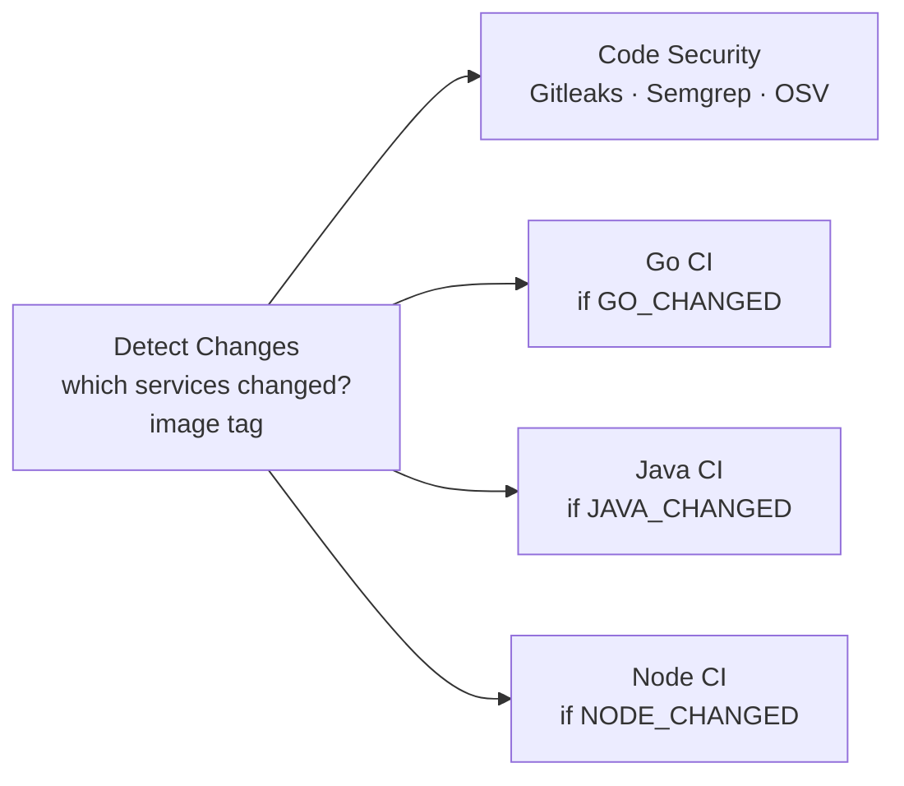

# Aumovio CI Demo – Harness CI for a Go / Java / Node.js monorepo

A small but realistic vehicle-telemetry platform plus a Harness CI pipeline that builds, tests,
packages, publishes and scans all three services. It exists to demo (and learn) every native
Harness CI acceleration feature in one run.

```
aumovio-ci-demo/
├── services/
│   ├── telemetry-ingest/   Go 1.24     HTTP ingest API, alert rules, aggregator     (34 tests)
│   ├── fleet-service/      Java 17     Maven multi-module (fleet-core + fleet-api)  (42 tests)
│   └── dashboard-api/      Node 20     HTTP API, Jest + jest-junit, ESLint          (39 tests)
├── scripts/ci/detect-changes.sh        monorepo change detection (sourced by the pipeline)
├── .ticonfig.yaml                      files Test Intelligence ignores
└── .harness/
    ├── pipelines/   aumovio_monorepo_ci.yaml            flat pipeline (import this first)
    │                aumovio_monorepo_ci_templated.yaml  same flow built from templates
    ├── templates/   go_ci_stage, java_maven_ci_stage, node_jest_ci_stage, trivy_scan_har_image
    ├── triggers/    pr_validation, pr_closed_ti_baseline, push_main (disabled)
    ├── inputsets/   manual_main_full_build, manual_pr_build
    └── policies/    5 OPA policies (Rego)
```

## Pipeline flow



Each language stage runs the same shape:
**restore cache → lint/static checks → tests → build → start app as Background step → smoke test → Build and Push to HAR → Trivy scan of the pushed image.**

| Stage | Steps |
|---|---|
| Detect Changes | Diffs the PR against its base commit; outputs `GO_CHANGED`, `JAVA_CHANGED`, `NODE_CHANGED`, `IMAGE_TAG` (`pr-<n>-<sha>`), `HAR_REPO_PATH` |
| Code Security | Gitleaks (secrets), Semgrep (SAST), OSV-Scanner (SCA) in parallel |
| Go CI | go mod download → golangci-lint ‖ go vet → unit tests split across 2 parallel steps (`-race`, JUnit) → static binary → smoke test → push → Trivy |
| Java CI | Test step with Test Intelligence → `mvn package` with Build Intelligence → smoke test → push → Trivy |
| Node CI | npm ci → ESLint ‖ Jest Test step with Test Intelligence → smoke test → push → Trivy |

## Where each Harness feature lives

| Feature | Where in the YAML | What to show |
|---|---|---|
| Harness Cloud | `runtime.type: Cloud` on every stage | No build infrastructure to manage |
| Test Intelligence (Java, Jest) | `type: Test`, `intelligenceMode: true` | Tests tab: "selected X of Y tests" and the call graph |
| Build Intelligence (Maven) | `buildIntelligence.enabled: true` on Java CI | Second run of `mvn package` shows cache hits, much faster |
| Cache Intelligence | `caching:` on each language stage (Go mod/build/lint caches, `~/.m2`, npm cache) | "Restore Cache" / "Save Cache" steps, dependency download skipped |
| Docker layer caching | `caching: true` on Build and Push | Unchanged layers reused on the second run |
| Test splitting | `strategy.parallelism: 2` on Go unit tests, split by `HARNESS_NODE_INDEX` | Two test nodes running different packages |
| Background steps + smoke tests | `type: Background` service reached by its step id | Real HTTP calls against the built app before it is published |
| Harness Artifact Registry | `BuildAndPushDockerRegistry` with `registryRef` | Images and tags in the `aumovio-snapshot` registry |
| STO | Gitleaks, Semgrep, OsvScanner, AquaTrivy steps | Security Tests tab with deduplicated findings |
| Conditional stages | `when.condition` on Detect Changes outputs | Change one service, only that stage runs |
| Parallelism | `parallel:` stages and steps | Execution graph |
| Templates | `.harness/templates/` | Adding a service = one templated stage |
| OPA governance | `.harness/policies/` | Save a pipeline with `Ignore` or `node:latest` and see it blocked |
| Failure strategies | Retry on Connectivity/Timeout, then fail | Robustness without hiding real failures |
| Triggers | `.harness/triggers/` | PR opened → pipeline starts; new push auto-aborts the old run |

## One-time setup in Harness

Everything is at org `testprameet`, project `testproj`. Do these in order.

1. **Push this folder to GitHub** as a repository named `aumovio-ci-demo` with default branch `main`:
   ```bash
   cd aumovio-ci-demo
   git init -b main && git add . && git commit -m "Aumovio CI demo"
   git remote add origin https://github.com/<your-org>/aumovio-ci-demo.git
   git push -u origin main
   ```
2. **Check the GitHub connector.** The pipeline uses `connectorRef: harness_testing` (the identifier of the
   `harness-testing` connector). Open the connector and confirm:
   - The identifier. If it is different, replace `harness_testing` in the pipelines and triggers. If the connector lives at org or account level, use `org.harness_testing` or `account.harness_testing`.
   - The URL type. For an **account** URL keep `repoName: aumovio-ci-demo`. For a **repository** URL pointing at this repo, delete the `repoName` lines.
   - API access is enabled, so Harness can register webhooks and post PR status checks.
3. **Create the Artifact Registry**: Artifact Registry → New Registry → Docker → identifier `aumovio-snapshot`.
   A different name works too; change the `har_registry` pipeline variable.
4. **Create two secrets** (Project Settings → Secrets → Text), used by Trivy to pull the image from HAR:
   - `har_username`: the email of the Harness user or service account.
   - `har_api_token`: a Harness API token (PAT or service account token) for that identity with Artifact Registry view access.
5. **Ask Harness support to enable `CI_ENABLE_RUNTESTV2_JS`** on the account. Jest Test Intelligence needs it.
   Without it the Node Test step still runs every test; it just doesn't select a subset.
6. **Import the templates** (Project → Templates → New Template → Import from YAML / paste YAML), in this order:
   `step_trivy_scan_har_image.yaml`, then `stage_go_ci.yaml`, `stage_java_maven_ci.yaml`, `stage_node_jest_ci.yaml`.
7. **Create the pipelines.** Pipelines → Create → Inline → YAML view → paste
   `aumovio_monorepo_ci.yaml`. Optionally do the same for `aumovio_monorepo_ci_templated.yaml`. If the
   templated one shows a template-input warning, open it in Pipeline Studio and click **Reconcile**.
8. **Create the triggers.** Pipeline → Triggers → New Trigger → GitHub → YAML view → paste `pr_validation.yaml`, then
   `pr_closed_ti_baseline.yaml`. `push_main.yaml` is optional and disabled.
   If the connector has no API access, copy each trigger's webhook URL into GitHub → Settings → Webhooks
   (content type `application/json`, events: Pull requests).
9. **Create the input sets** (Pipeline → Input Sets → New → YAML) from `.harness/inputsets/`.
10. **Create the OPA policies** (Project Settings → Policies → New Policy). Create one policy per `.rego` file and test each in the policy editor. Then create a
    policy set:
    - Entity type **Pipeline**, event **On Save** and a second set **On Run**.
    - Add all five policies with severity **Warn & continue** first. Switch to **Error & exit** once the
      team has seen the warnings.
    - For vulnerability gating, create a policy from the library sample *Security Tests → "Warn or Block
      vulnerabilities by severity"* (Use this sample), put it in a policy set with entity **Security Tests**
      and event **On Step**, enable **Enforced**, then attach it to each scan step under
      Advanced → Policy Enforcement.

## Demo script (about 20 minutes)

**Run 1 – full baseline.** Run the pipeline with input set *Manual – main, build everything*.
Everything is cold: dependencies download, every test runs (this builds the Test Intelligence
baseline), the Maven build cache fills, and Docker layers are pushed. Note the duration of each stage.

**Run 2 – same commit again.** Run it again with the same input set.
Show the Cache Intelligence restore, Build Intelligence cache hits in `mvn package`, Docker layer cache
reuse, and the much shorter durations.

**Run 3 – PR touching only Java.**
```bash
git checkout -b feature/battery-threshold
# e.g. change the DEGRADED threshold in
# services/fleet-service/fleet-core/src/main/java/com/aumovio/fleet/core/BatteryHealth.java
git commit -am "Tune battery degradation threshold" && git push -u origin HEAD
```
Open a PR to `main`. The `pr_validation` trigger fires. Show the following:
- Detect Changes: `JAVA_CHANGED=true`; the Go and Node stages are **skipped**.
- Test Intelligence: only the tests touching `BatteryHealth` run. TI selection on PRs starts after the
  first PR into `main` has been merged (that merge fires `pr_closed_ti_baseline`, which finalizes the baseline). So
  merge one warm-up PR before the live demo.
- Push one more commit to the same PR and the previous run is auto-aborted.

**Run 4 – PR touching only Go.** Change `services/telemetry-ingest/internal/telemetry/alerts.go`.
Only Go CI runs. Show the two parallel unit test nodes and the per-package split in the logs.

**Run 5 – governance.** In Pipeline Studio, change a step image to `node:latest` or a failure strategy
to *Ignore* and save. The OPA policy set warns or blocks with a clear message.

**Security.** Open the **Security Tests** tab of any run: Gitleaks, Semgrep, OSV and Trivy findings in one
deduplicated view, with exemption workflow.

**Artifacts.** Open Artifact Registry → `aumovio-snapshot`: three images tagged `pr-<n>-<sha>` /
`main-<sha>` with the commit SHA label.

## Run the services locally

```bash
# Go
cd services/telemetry-ingest && go test -race ./... && go run ./cmd/telemetry-ingest        # :8080
# Java
cd services/fleet-service && mvn -B verify && java -jar fleet-api/target/fleet-api.jar     # :8081
# Node
cd services/dashboard-api && npm ci && npm run lint && npm test && npm start              # :3000
```

| Service | Endpoints |
|---|---|
| telemetry-ingest | `GET /healthz`, `POST /v1/readings`, `GET /v1/vehicles`, `GET /v1/vehicles/{id}/stats` |
| fleet-service | `GET /healthz`, `GET /v1/vehicles`, `GET /v1/vehicles/{vin}`, `GET /v1/fleet/report` |
| dashboard-api | `GET /healthz`, `GET /v1/fleet/summary`, `GET/PUT /v1/vehicles/{id}` (`?units=imperial`) |

## Design notes and caveats

- **Go has no Test Intelligence** in Harness. Go relies on change detection, test splitting and the Go build/test cache instead.
- **Java tests are not split.** Split steps share one VM workspace, and parallel Maven runs would clash on `target/`. Test Intelligence handles the speed-up.
- **Build Intelligence only accelerates Maven running in a Run/Test step**, not inside a Dockerfile. So the JAR is built in
  the pipeline and the Dockerfile just copies it. The same pattern is used for Go (copy the static binary).
- **Cache keys are unique per stage** (Cache Intelligence requires this for parallel stages) and are tied to
  `go.mod`, `pom.xml` and `package-lock.json` checksums. Cached data is kept for 15 days.
- **Changes under `.harness/`, `scripts/ci/` or `.ticonfig.yaml` rebuild everything.** The `force_all` variable does the same on demand.
- The Detect Changes step is **sourced**, with no `exit`, because Harness drops output variables when a script exits explicitly.
- The YAML was validated against the public Harness v0 schema and the policies were tested with OPA,
  but nothing has been applied to a live account yet. Expect to adjust identifiers (connector, registry,
  secrets) on first import.
