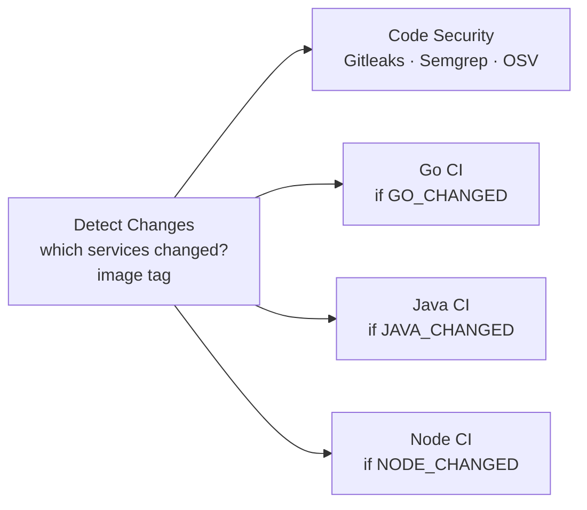
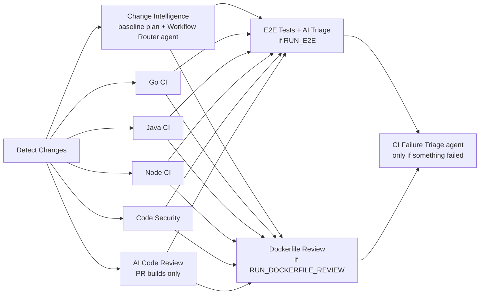
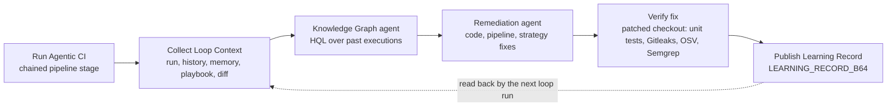

# Aumovio CI Demo – Harness CI for a Go / Java / Node.js monorepo

A small but realistic vehicle-telemetry platform plus a Harness CI pipeline that builds, tests,
packages, publishes and scans all three services. It exists to demo (and learn) every native
Harness CI acceleration feature in one run.

```
aumovio-ci-demo/
├── services/
│   ├── telemetry-ingest/   Go 1.24     HTTP ingest API, alert rules, aggregator     (34 tests)
│   ├── fleet-service/      Java 17     Maven multi-module (fleet-core + fleet-api)  (42 tests)
│   └── dashboard-api/      Node 20     HTTP API, Jest + jest-junit, ESLint          (39 tests)
├── scripts/ci/detect-changes.sh        monorepo change detection (sourced by the pipeline)
├── scripts/ci/*.mjs                    evidence collectors and quality gates for the agentic pipeline
├── tests/e2e/                          cross-service E2E suite (node:test, 20 tests) and its runner
├── .ticonfig.yaml                      files Test Intelligence ignores
├── .harness/                           auto-created by Harness Git Experience (see setup)
│   └── orgs/testprameet/projects/testproj/
│       ├── pipelines/
│       │   ├── aumovio_monorepo_ci.yaml                  flat pipeline
│       │   ├── aumovio_monorepo_ci_agentic.yaml          flat pipeline + Worker Agents, E2E and AI gates
│       │   ├── aumovio_monorepo_ci_templated.yaml        same flow built from templates
│       │   └── aumovio_monorepo_ci/input_sets/           manual_main_full_build, manual_pr_build
│       └── templates/
│           ├── trivy_scan_har_image/v1.yaml              step template
│           ├── go_ci_stage/v1.yaml                       stage template
│           ├── java_maven_ci_stage/v1.yaml               stage template
│           └── node_jest_ci_stage/v1.yaml                stage template
└── harness-manual/                     not supported by auto-creation, create these by hand
    ├── triggers/    pr_validation, pr_closed_ti_baseline, push_main (disabled)
    ├── policies/    6 OPA policies (Rego)
    ├── agents/      3 custom Worker Agent definitions (paste into AI > Worker Agents)
    └── connectors/  Harness MCP and GitHub MCP connectors used by the agents
```

## Pipeline flow



Each language stage runs the same shape:
**restore cache → lint/static checks → tests → build → start app as Background step → smoke test → Build and Push to HAR → Trivy scan of the pushed image.**

| Stage | Steps |
|---|---|
| Detect Changes | Diffs the PR against its base commit; outputs `GO_CHANGED`, `JAVA_CHANGED`, `NODE_CHANGED`, `IMAGE_TAG` (`pr-<n>-<sha>`), `HAR_REPO_PATH` |
| Code Security | Gitleaks (secrets), Semgrep (SAST), OSV-Scanner (SCA) in parallel |
| Go CI | go mod download → golangci-lint ‖ go vet → unit tests split across 2 parallel steps (`-race`, JUnit) → static binary → smoke test → push → Trivy |
| Java CI | Test step with Test Intelligence → `mvn package` with Build Intelligence → smoke test → push → Trivy |
| Node CI | npm ci → ESLint ‖ Jest Test step with Test Intelligence → smoke test → push → Trivy |

## Where each Harness feature lives

| Feature | Where in the YAML | What to show |
|---|---|---|
| Harness Cloud | `runtime.type: Cloud` on every stage | No build infrastructure to manage |
| Test Intelligence (Java, Jest) | `type: Test`, `intelligenceMode: true` | Tests tab: "selected X of Y tests" and the call graph |
| Build Intelligence (Maven) | `buildIntelligence.enabled: true` on Java CI | Second run of `mvn package` shows cache hits, much faster |
| Cache Intelligence | `caching:` on each language stage (Go mod/build/lint caches, `~/.m2`, npm cache) | "Restore Cache" / "Save Cache" steps, dependency download skipped |
| Docker layer caching | `caching: true` on Build and Push | Unchanged layers reused on the second run |
| Test splitting | `strategy.parallelism: 2` on Go unit tests, split by `HARNESS_NODE_INDEX` | Two test nodes running different packages |
| Background steps + smoke tests | `type: Background` service reached by its step id | Real HTTP calls against the built app before it is published |
| Harness Artifact Registry | `BuildAndPushDockerRegistry` with `registryRef` | Images and tags in the `aumovio-snapshot` registry |
| STO | Gitleaks, Semgrep, OsvScanner, AquaTrivy steps | Security Tests tab with deduplicated findings |
| Conditional stages | `when.condition` on Detect Changes outputs | Change one service, only that stage runs |
| Parallelism | `parallel:` stages and steps | Execution graph |
| Templates | `.harness/orgs/testprameet/projects/testproj/templates/` | Adding a service = one templated stage |
| OPA governance | `harness-manual/policies/` | Save a pipeline with `Ignore` or `node:latest` and see it blocked |
| Failure strategies | Retry on Connectivity/Timeout, then fail | Robustness without hiding real failures |
| Triggers | `harness-manual/triggers/` | PR opened → pipeline starts; new push auto-aborts the old run |

## One-time setup in Harness

Everything is created at org `testprameet`, project `testproj`. Pipelines, input sets and templates are
**auto-created** by Harness Git Experience when their YAML lands on `main` under
`.harness/orgs/testprameet/projects/testproj/...`
([docs](https://developer.harness.io/harness-platform/use-harness-platform/git-experience/autocreation-of-entities)).
They become remote entities: Harness reads them from Git, so later pushes to `main` update them.
Triggers and OPA policies are not supported by auto-creation; they live in `harness-manual/` and are created by hand.

Do these in order.

1. **Check the GitHub connector.** The YAML uses `connectorRef: harnessiacm`, a project-level
   GitHub connector. Open the connector and confirm:
   - The identifier. If it is different, replace `harnessiacm` in the pipelines and triggers. If the connector lives at org or account level, use `org.harnessiacm` or `account.harnessiacm`.
   - The URL type. For an **account** URL keep `repoName: aumovio-ci-demo`. For a **repository** URL pointing at this repo, delete the `repoName` lines.
   - API access is enabled, so Harness can register webhooks and post PR status checks.
2. **Create the Artifact Registry**: Artifact Registry → New Registry → Docker → identifier `aumovio-snapshot`.
   A different name works too; change the `har_registry` pipeline variable.
3. **Create two secrets** (Project Settings → Secrets → Text), used by Trivy to pull the image from HAR:
   - `har_username`: the email of the Harness user or service account.
   - `har_api_token`: a Harness API token (PAT or service account token) for that identity with Artifact Registry view access.
4. **Ask Harness support to enable `CI_ENABLE_RUNTESTV2_JS`** on the account. Jest Test Intelligence needs it.
   Without it the Node Test step still runs every test; it just doesn't select a subset.
5. **Push the code without the Harness entities first.** Create an empty GitHub repo `aumovio-ci-demo`, then:
   ```bash
   cd aumovio-ci-demo
   git init -b main
   git add . ':!.harness'
   git commit -m "Aumovio CI demo: services and CI scripts"
   git remote add origin https://github.com/<your-org>/aumovio-ci-demo.git
   git push -u origin main
   ```
6. **Register a project-level webhook** so Harness sees pushes to `.harness/`:
   Project `testproj` → Project Settings → Webhooks → New Webhook → connector `harnessiacm`,
   repository `aumovio-ci-demo`, folder `.harness`. It must be project scope to create project entities.
7. **Push the entities in dependency order.** Only pushes to the default branch (`main`) are auto-created.
   Templates have to exist before the pipelines that use them, and a pipeline before its input sets,
   so push in four small commits:
   ```bash
   H=.harness/orgs/testprameet/projects/testproj

   git add $H/templates/trivy_scan_har_image
   git commit -m "Harness: Trivy step template" && git push

   git add $H/templates/go_ci_stage $H/templates/java_maven_ci_stage $H/templates/node_jest_ci_stage
   git commit -m "Harness: stage templates" && git push

   git add $H/pipelines/aumovio_monorepo_ci.yaml $H/pipelines/aumovio_monorepo_ci_templated.yaml
   git commit -m "Harness: pipelines" && git push

   git add $H/pipelines/aumovio_monorepo_ci/input_sets
   git commit -m "Harness: input sets" && git push
   ```
   After each push, check Project Settings → Webhooks → **Events**: each file should show as processed.
   If something failed, open the event to see why, fix the YAML, and push again.
   If the templated pipeline shows a template-input warning, open it in Pipeline Studio and click **Reconcile**.
8. **Create the triggers by hand.** Pipeline `aumovio_monorepo_ci` → Triggers → New Trigger → GitHub → YAML view →
   paste `harness-manual/triggers/pr_validation.yaml`, then `pr_closed_ti_baseline.yaml`. `push_main.yaml` is
   optional and disabled. The triggers set `pipelineBranchName`, which remote pipelines need: PR triggers load
   the pipeline YAML from the PR's target branch (`main`).
   If the connector has no API access, copy each trigger's webhook URL into GitHub → Settings → Webhooks
   (content type `application/json`, events: Pull requests).
9. **Change the manual PR input set** if you plan to use it: it has a placeholder PR number `1`.
10. **Create the OPA policies by hand** (Project Settings → Policies → New Policy). Create one policy per file in `harness-manual/policies/` and test each in the policy editor. Then create a
    policy set:
    - Entity type **Pipeline**, event **On Save** and a second set **On Run**.
    - Add all five policies with severity **Warn & continue** first. Switch to **Error & exit** once the
      team has seen the warnings.
    - For vulnerability gating, create a policy from the library sample *Security Tests → "Warn or Block
      vulnerabilities by severity"* (Use this sample), put it in a policy set with entity **Security Tests**
      and event **On Step**, enable **Enforced**, then attach it to each scan step under
      Advanced → Policy Enforcement.

## Demo script (about 20 minutes)

**Run 1 – full baseline.** Run the pipeline with input set *Manual – main, build everything*.
Everything is cold: dependencies download, every test runs (this builds the Test Intelligence
baseline), the Maven build cache fills, and Docker layers are pushed. Note the duration of each stage.

**Run 2 – same commit again.** Run it again with the same input set.
Show the Cache Intelligence restore, Build Intelligence cache hits in `mvn package`, Docker layer cache
reuse, and the much shorter durations.

**Run 3 – PR touching only Java.**
```bash
git checkout -b feature/battery-threshold
# e.g. change the DEGRADED threshold in
# services/fleet-service/fleet-core/src/main/java/com/aumovio/fleet/core/BatteryHealth.java
git commit -am "Tune battery degradation threshold" && git push -u origin HEAD
```
Open a PR to `main`. The `pr_validation` trigger fires. Show the following:
- Detect Changes: `JAVA_CHANGED=true`; the Go and Node stages are **skipped**.
- Test Intelligence: only the tests touching `BatteryHealth` run. TI selection on PRs starts after the
  first PR into `main` has been merged (that merge fires `pr_closed_ti_baseline`, which finalizes the baseline). So
  merge one warm-up PR before the live demo.
- Push one more commit to the same PR and the previous run is auto-aborted.

**Run 4 – PR touching only Go.** Change `services/telemetry-ingest/internal/telemetry/alerts.go`.
Only Go CI runs. Show the two parallel unit test nodes and the per-package split in the logs.

**Run 5 – governance.** In Pipeline Studio, change a step image to `node:latest` or a failure strategy
to *Ignore* and save. The OPA policy set warns or blocks with a clear message.

**Security.** Open the **Security Tests** tab of any run: Gitleaks, Semgrep, OSV and Trivy findings in one
deduplicated view, with exemption workflow.

**Artifacts.** Open Artifact Registry → `aumovio-snapshot`: three images tagged `pr-<n>-<sha>` /
`main-<sha>` with the commit SHA label.

## Agentic pipeline: Harness Worker Agents in CI

`aumovio_monorepo_ci_agentic` keeps every build, test and security stage of the flat pipeline unchanged and
adds AI agents where they decide something useful. The principle throughout: **agents recommend, deterministic
gates decide, and a missing or wrong agent answer can never make the pipeline less strict.**



| Agent | Type | Stage | Inputs it reads | Outputs | Who decides |
|---|---|---|---|---|---|
| Workflow Router | custom, `ca_workflow_router` | Change Intelligence | change context and diff, recent executions (Harness MCP), PR intent (GitHub MCP) | `RUN_E2E`, `RUN_DOCKERFILE_REVIEW`, `RISK_LEVEL`, `CHANGE_CATEGORY`, `RATIONALE` | `resolve-plan.mjs`: the agent can turn workflows on and raise risk, never the reverse |
| E2E Failure Triage | custom, `ca_e2e_failure_triage_agent` | E2E Tests | failing tests, assertions, diff signals, git history, service logs, last green run (Harness MCP), PR description (GitHub MCP) | `VERDICT` (REGRESSION, OUTDATED_TEST, FLAKY, ENVIRONMENT, MIXED, UNKNOWN), `CONFIDENCE`, per-class counts, `SUMMARY`, report | `e2e-gate.mjs`, fail-closed (table below) |
| Dockerfile Optimizer | custom, `ca_dockerfile_optimizer_agent` | Dockerfile Review | Dockerfiles, hadolint results, build-context size, `.dockerignore` presence | `BLOCKING_FINDINGS`, `TOTAL_FINDINGS`, `ESTIMATED_CONTEXT_SAVINGS_MB`, report and a ready-to-apply patch | `dockerfile-gate.mjs`: hadolint errors or agent blocking findings fail; recommendations warn |
| Code Review | Harness-managed | AI Code Review | the PR diff | review comments | advisory |
| CI Failure Triage | custom, `ca_ci_failure_triage` | CI Failure Triage (only when the run failed) | failed stages and steps (execution API), unit tests re-run for the failed services, change diff, repository, execution logs and scan results (Harness MCP) | `FAILURE_CATEGORY` (UNIT_TEST, SECRET, VULNERABLE_DEPENDENCY, SAST, E2E, DOCKERFILE, BUILD, ENVIRONMENT, MIXED, UNKNOWN), `ROOT_CAUSE`, `SUSPECT_FILES`, `CONFIDENCE`, `FIX_OWNER`, report and `ci-fix.patch` | advisory: the run has already failed; the agent explains why and proposes a patch, and never changes code |

**E2E gate decisions.** A failure that fails again on retry is "consistent"; one that passes on retry is "flaky".

| E2E result | Triage verdict | Decision |
|---|---|---|
| all passed | not run | pass |
| services unhealthy | any | fail: the change could not be verified |
| only flaky failures | anything but a confident REGRESSION | pass with warning |
| consistent failures | none, UNKNOWN, or confidence below `triage_confidence_threshold` | fail: human review |
| consistent failures | confident OUTDATED_TEST | pass with warning if `outdated_test_policy=warn`, fail if `block` |
| consistent failures | REGRESSION, MIXED, FLAKY, ENVIRONMENT | fail |

Every agent is read-only by instruction and by credential (read-only Harness MCP credential). Agent steps
retry once and then mark themselves successful, so an agent outage never fails the build on its own; the gate
step that follows then applies the deterministic fallback. Agent versions are pinned and enforced by the
`ci_agent_steps_pinned` policy, so editing an agent in the catalog cannot silently change gating behaviour.

### Setup for the agentic pipeline

1. **Harness MCP connector**: the agents use the existing project connector `mcpconnector`; use a read-only
   credential (Pipeline View, Execution View). `harness-manual/connectors/aumovio_harness_mcp.yaml` is a
   reference definition if you need to create one.
2. **GitHub MCP connector (optional)**: the agents work without it, using the PR title and commit messages.
   To give them PR descriptions and labels, create secret `github_mcp_pat` (fine-grained, read-only Contents,
   Pull requests and Metadata) and `harness-manual/connectors/aumovio_github_mcp.yaml`, then add
   `aumovio_github_mcp` to `with.mcp` and `api.githubcopilot.com` to `with.allowed_domains` in the router and
   triage agents.
3. **Custom agents**: AI → Worker Agents → + Create → YAML tab. Paste each file from `harness-manual/agents/`
   and save it as version `1.0.0` with the identifier given in the file header. They use the Harness-managed
   `account.harnessAnthropic` model connector, so no LLM key is needed.
4. **Managed agent**: in AI → Worker Agents, find the Code Review agent and replace the `agentName` value
   `aiCodeReviewAgent` in the pipeline if yours differs.
5. **Policy (optional)**: the agent steps currently use the latest stable agent version. To enforce pinning,
   change each `agentName` to `name@x.y.z` and add `harness-manual/policies/ci_agent_steps_pinned.rego` to the
   policy set.
6. Push `aumovio_monorepo_ci_agentic.yaml`; Git Experience creates the pipeline.
7. After the first run, open an Agent step group and check the inner step name on the Output tab. The pipeline
   assumes `<agent identifier>_1` (for example `ca_e2e_failure_triage_agent_1`), as in the Harness docs.

### Scenario branches for testing the agents

`main` is the green baseline. Each `scenario/*` branch is **one commit on top of `main`** that plants one kind of
problem, written the way it would look in a real change (plausible commit message, no hints in the code). Run
`aumovio_monorepo_ci_agentic` manually and pick the scenario branch both for the pipeline YAML and for the
codebase (build type *Git Branch*), then compare what the agents report with the expected outcome below.

| Branch | What is planted | Should fail in | Agent that should explain it | Expected verdict |
|---|---|---|---|---|
| `main` | nothing | – (green) | Workflow Router only | plan confirmed, no triage |
| `scenario/unit-test-go` | battery-low warning check changed from `<=` to `<`, so exactly 20 % no longer alerts | Go CI → unit tests | CI Failure Triage | `UNIT_TEST`, `alerts.go`, application bug |
| `scenario/unit-test-java` | range reserve applied as a multiplier instead of being subtracted | Java CI → unit tests | CI Failure Triage | `UNIT_TEST`, `RangeEstimator.java`, application bug |
| `scenario/unit-test-node` | km to miles conversion inverted during a "units refactor" | Node CI → Jest | CI Failure Triage | `UNIT_TEST`, `units.js`, application bug |
| `scenario/vulnerable-dependency` | `log4j-core 2.14.1` (Log4Shell) in fleet-core and `minimist 1.2.5` in dashboard-api | Code Security → OSV (critical) | CI Failure Triage | `VULNERABLE_DEPENDENCY`, upgrade to fixed versions |
| `scenario/hardcoded-secret` | a partner API token and an RSA signing key hard-coded in `dashboard-api/src/lib/partnerExport.js` | Code Security → Gitleaks | CI Failure Triage | `SECRET`, move to configuration and rotate |
| `scenario/sast-injection` | a fleet-api document endpoint that builds a file path from the request URL | Code Security → Semgrep (high, `PATH_TRAVERSAL_IN`) | CI Failure Triage (and Code Review on a PR) | `SAST`, path traversal, normalise and confine to the docs directory |
| `scenario/e2e-regression` | telemetry aggregator "refactor" with a wrong running average; Go unit tests still pass | E2E Tests → quality gate | E2E Failure Triage, then CI Failure Triage summarises | `REGRESSION` |
| `scenario/e2e-outdated-test` | intentional dashboard API rename with unit tests updated, E2E test not updated | passes with a warning (`outdated_test_policy=warn`) or fails (`block`) | E2E Failure Triage | `OUTDATED_TEST` with the assertion change |
| `scenario/dockerfile-issues` | dashboard-api image switched to `node:latest`, single stage, `COPY . .`, dev dependencies and debug tools installed, running as root | Dockerfile Review → gate | Dockerfile Optimizer, then CI Failure Triage | blocking findings: root user, mutable tag |
| `scenario/mixed` | the Go unit-test bug, the hard-coded secret and the vulnerable dependency together | Go CI and Code Security | CI Failure Triage | `MIXED`, three separate root causes |

What to look at in each run:

- **Resolve Workflow Plan**: the router's decision table and whether it escalated the baseline (risk is raised to
  `high` for alert logic, security-sensitive code and dependency changes).
- **CI Failure Triage → Publish Triage Report**: category, confidence, root cause, suspect files, the full report
  and the proposed `ci-fix.patch`. Check whether the patch is the fix you would write.
- **E2E Tests → E2E Quality Gate** and **Dockerfile Review → Dockerfile Gate** for the E2E and Dockerfile branches.

Keep the branches one commit ahead of `main`: on branch builds, change detection compares `HEAD~1..HEAD`. To refresh
a branch after `main` moves, rebase it (`git rebase origin/main`) and force-push.

### CI learning loop with the Harness Knowledge Graph

`aumovio_ci_learning_loop` wraps the agentic pipeline in a closed learning loop. It is report-only: agents write
patches and a playbook proposal as files, and nothing is committed.



| Stage / step | What it does |
|---|---|
| Run Agentic CI | Pipeline chaining: runs `aumovio_monorepo_ci_agentic` on `target_branch`. Because the learning stage starts after that execution has finished, it never waits on a running execution. |
| Collect Loop Context | `scripts/ci/learning/loop-context.mjs`: failed stages and steps and the CI Failure Triage verdict of the chained run, the last 20 CI executions, learning records of the last 10 loop runs (memory), `knowledge/ci-playbook.md` from `main`, and the branch diff against `main`. |
| Knowledge Graph Insights | `ca_ci_knowledge_graph` agent. Uses the Harness MCP Knowledge Graph tools (`hql_query`, `kg_grammar`, `kg_queryable_type_summary`) to classify each failure as NEW, RECURRING, FLAKY or INFRA and report failure rates, slow steps and fix history. |
| Remediation Plan | `ca_ci_remediation` agent. Reuses fixes that were verified before, never repeats a fix that failed verification, and proposes `code-fix.patch`, `pipeline-fix.patch` (for the agentic pipeline), strategy changes and an updated `ci-playbook.md`. |
| Verify Fix | Applies `code-fix.patch` to this stage's checkout and re-runs the affected unit tests, plus Gitleaks, OSV (critical) and Semgrep (high) when security is involved. |
| Publish Learning Record | Prints the full report and exports `LEARNING_RECORD_B64`, `FIX_VERIFICATION` (VERIFIED, FAILED, NO_PATCH, ...), `PATTERN_KEY` and `REMEDIATION_TYPE`. The next loop run reads these back as memory. |

How it learns: the Knowledge Graph supplies execution history, the learning records supply what the agents concluded
and whether the fix was verified, and the playbook holds the knowledge a human has approved. Committing the proposed
`ci-playbook.md` is the review step that promotes a lesson into the playbook.

Setup:

1. Create two Worker Agents from `harness-manual/agents/ci_knowledge_graph_agent.yaml` (identifier
   `ca_ci_knowledge_graph`) and `harness-manual/agents/ci_remediation_agent.yaml` (identifier `ca_ci_remediation`).
2. Import or reload `aumovio_ci_learning_loop` from Git (branch `main`), along with its input sets.
3. Optional: create the nightly trend trigger from `harness-manual/triggers/learning_loop_nightly.yaml`
   (`run_ci=false`, analyses history only).

Run it with an input set: `main`, `trend_history_only`, or `scenario_<name>` for each scenario branch. Run the same
scenario twice to see the loop learn: the second run should report the pattern as RECURRING and reuse the fix that
was verified the first time.

### Run the E2E suite locally

```bash
# start the three services as in "Run the services locally", then:
node tests/e2e/run.mjs        # writes tests/e2e/reports/{junit-*.xml,outputs.env,evidence/e2e-summary.json}
```

## Run the services locally

```bash
# Go
cd services/telemetry-ingest && go test -race ./... && go run ./cmd/telemetry-ingest        # :8080
# Java
cd services/fleet-service && mvn -B verify && java -jar fleet-api/target/fleet-api.jar     # :8081
# Node
cd services/dashboard-api && npm ci && npm run lint && npm test && npm start              # :3000
```

| Service | Endpoints |
|---|---|
| telemetry-ingest | `GET /healthz`, `POST /v1/readings`, `GET /v1/vehicles`, `GET /v1/vehicles/{id}/stats` |
| fleet-service | `GET /healthz`, `GET /v1/vehicles`, `GET /v1/vehicles/{vin}`, `GET /v1/fleet/report` |
| dashboard-api | `GET /healthz`, `GET /v1/fleet/summary`, `GET/PUT /v1/vehicles/{id}` (`?units=imperial`) |

## Design notes and caveats

- **Go has no Test Intelligence** in Harness. Go relies on change detection, test splitting and the Go build/test cache instead.
- **Java tests are not split.** Split steps share one VM workspace, and parallel Maven runs would clash on `target/`. Test Intelligence handles the speed-up.
- **Build Intelligence detects Maven from a `pom.xml` at the workspace root.** The root `pom.xml` aggregates the
  Java services, and the pipeline runs `mvn ... -pl services/fleet-service -amd` from the root. Running Maven
  only inside `services/fleet-service` makes Harness log "Build Intelligence injection skipped: no supported
  build tool detected".
- **Build Intelligence only accelerates Maven running in a Run/Test step**, not inside a Dockerfile. So the JAR is built in
  the pipeline and the Dockerfile just copies it. The same pattern is used for Go (copy the static binary).
- **Cache keys are unique per stage** (Cache Intelligence requires this for parallel stages) and are tied to
  `go.mod`, `pom.xml` and `package-lock.json` checksums. Cached data is kept for 15 days.
- **Changes under `.harness/`, `scripts/ci/` or `.ticonfig.yaml` rebuild everything.** The `force_all` variable does the same on demand.
- The Detect Changes step is **sourced**, with no `exit`, because Harness drops output variables when a script exits explicitly.
- **Agent outputs come from the instructions.** Worker Agents publish variables they are told to output; there is no
  output key and no writing to `DRONE_OUTPUT`. Downstream steps reference
  `<+execution.steps.<agent step>.steps.<agent>_1.output.outputVariables.KEY>` because the Agent step expands into a step group.
- **The E2E stage rebuilds the Go binary and the JAR** rather than sharing artifacts across stages, because stages on
  Harness Cloud run on separate VMs. Cache Intelligence and Build Intelligence keep those rebuilds short.
- The YAML was validated against the public Harness v0 schema and the policies were tested with OPA,
  but nothing has been applied to a live account yet. Expect to adjust identifiers (connectors, registry,
  secrets) on first import.
